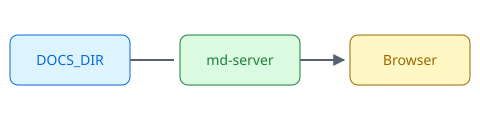

# Welcome

This folder is served by **md-server**. Replace it with your own docs by setting
`DOCS_DIR` in `.env`.

- [Getting started](guide/getting-started.md)
- [Configuration](guide/configuration.md)
- [API reference](reference/api.md)

